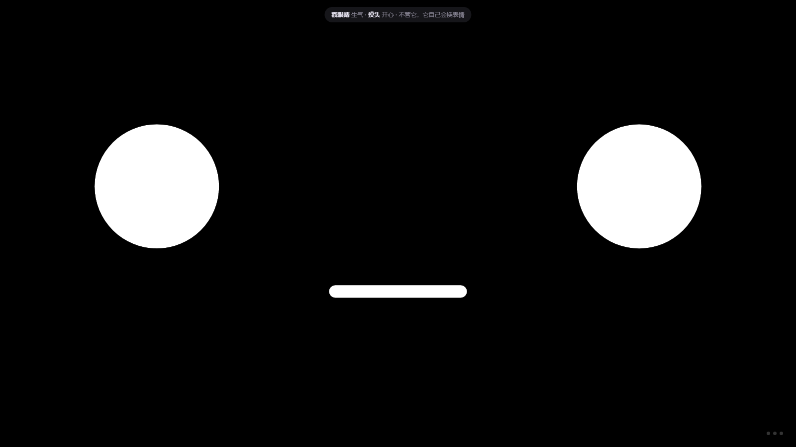
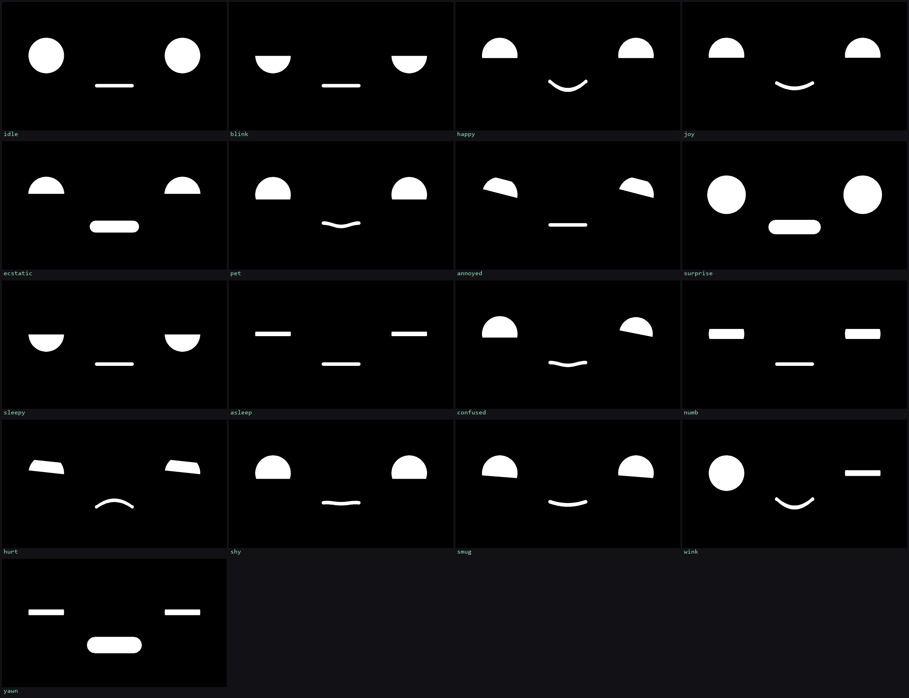
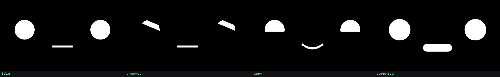
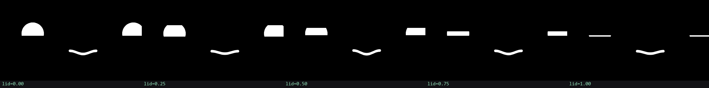
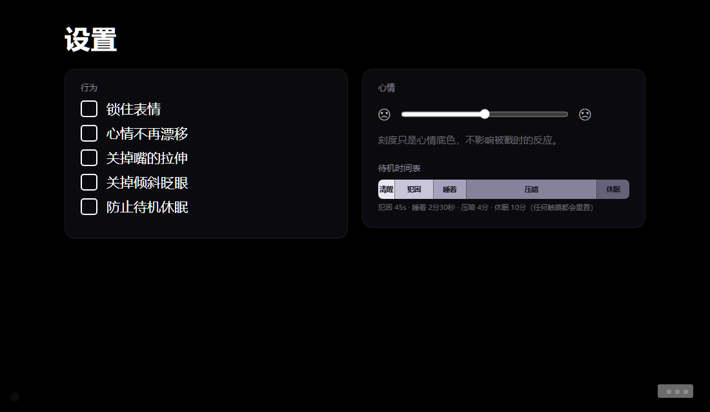
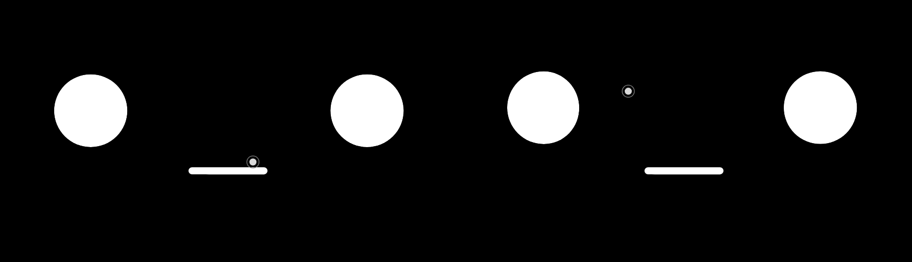

# O-O

> **本项目是向 Mike Inel 的 OuO 致敬。**
> 第一次看到那个方盒子里的一张脸能这么有生命感，就想着把它做成一个真正摆在桌上的东西。
> 这个项目里没有它的任何一行代码、任何一张资源——只有那份"它好像活着"的感觉，是我们想接着做下去的。

一个**黑白两色的桌面表情小怪物**，跑在 ESP32-S3 上。

一块触摸屏当它的脸，两个圆眼睛加一条横杠——就是它名字的样子：`O-O`。

没人理它的时候，它会自己犯困、睡着；摸它头会舒服地眯眼、慢慢眨一次眼皮；戳眼睛会不高兴地斜眼看你；连着戳太多次会彻底麻木给你看。

**[▶ 在线试玩](https://ws177.github.io/o-o/)** —— 不用装任何东西，在浏览器里就能戳它、摸它。

> **目标硬件**：正点原子 ATK-DNESP32S3（ESP32-S3 / 8MB Octal PSRAM / 16MB Flash）
> **开发状态**：表情引擎与网页渲染已完成并验证；屏幕驱动、音频、固件侧状态触发仍在进行中。

---

## 它长什么样

| 默认表情 | 全部 17 个姿态 |
|---|---|
|  |  |

| 表情对比 | 闭眼过程 |
|---|---|
|  |  |

| 设置页 | 触控点 |
|---|---|
|  |  |

---

## 设计思路

### 一套极简的视觉词汇

整张脸只有一个**实心圆**和一条**闭合多边形**：

- **眼睛** = 圆 ∩ 一条可旋转的「眼皮带」→ 改变带状区域就能得到 圆 / 上弦∩ / 下弦 / 斜切 / 细线 / 半阖
- **嘴** = 五种形状（横杠 / ω / ∪笑 / 张嘴团 / 撇嘴）按权重逐点插值
- **表情** = 一张姿态表，情绪只决定各姿态的权重

因为这个设计，**新增一个表情 = 在表里加一行数字**，不需要写代码。

### 一根主干、两枝果

```
        engine/engine.json          ← 唯一真相：姿态 / 权重 / 时序 / 时间表
                 │
     tools/gen_engine.py
        ┌────────┴────────┐
        ↓                 ↓
 firmware/main/       preview/o-o.html
 engine_poses.h       的生成段
   （C 固件）           （网页渲染器）
        └── --check ──────┘   任一侧被手改都会报错
```

常数只写在 JSON 里，两侧都由生成器产出。改一个表情数字 → 跑一次生成器 → 固件和网页同时更新，**不可能分叉**。

---

## 快速开始

### 只在浏览器里看（不需要硬件）

直接访问在线版：<https://ws177.github.io/o-o/>

或者用浏览器打开本地文件：

```
preview/o-o.html
```

它是单文件，本地模式自带完整引擎，可以点、可以摸、能看到全部动画。

> 想连真机的话，跑 `python tools/vscreen.py --port COM12`，再开 <http://127.0.0.1:8777/>，网页会变成板子的远程画面。

### 编译固件

需要 [ESP-IDF](https://github.com/espressif/esp-idf) v6.x。把 IDF 放到仓库根目录下（或设置 `IDF_PATH`）：

```powershell
# 1. 准备 WiFi 凭据（不会提交）
Copy-Item firmware/main/wifi_creds.h.example firmware/main/wifi_creds.h
#    然后编辑它，填上你的 2.4G 热点

# 2. 激活 IDF 环境
. .\scripts\idf-env.ps1

# 3. 编译
cd firmware
idf.py build
```

烧录：

```powershell
idf.py -p COM12 flash monitor
```

---

## 硬件

| 外设 | 说明 |
|---|---|
| **I2C0** | SDA=IO41, SCL=IO42 |
| **光感** | AP3216C @ 0x1E（环境光 → 自动压暗 / 加速犯困） |
| **加速度** | QMA6100P @ 0x12（倾斜 → 视线跟随；摇晃 → 晕；拿起 → 惊醒） |
| **RGB 屏** | R3-R7 / G2-G7 / B3-B7 / DE / PCLK，背光与复位经 XL9555 |
| **触摸** | 独立 I2C（IO38/IO39），GT9xxx |

> 厂商 BSP（`ltdc.c`、`xl9555.c`、`gt9xxx.c`、`qma6100p.c` 等）**不随本仓库分发**，请从开发板随机资料中获取。

---

## 交互一览

| 操作 | 反应 |
|---|---|
| 手指/鼠标靠近眼睛 | 眼睛被顶出凹陷并往旁边让 |
| 视线跟随 | 眼睛朝指针方向移动约 1/4 个眼半径 |
| 戳眼睛 | 眯成斜切楔形，保持数秒 |
| 戳嘴 / 下巴 | 惊吓：瞪眼 + 张嘴 |
| 摸头（按住） | 笑 → 眯眼 → 张嘴笑；松手后**慢慢眨一次眼**（猫表示信任的动作） |
| 连续戳 3~4 次 | 疑惑（歪头 + 大小眼） |
| 连续戳 6 次 | 麻木（面无表情，其它情绪一并压制） |
| 一直不理 | 45 秒犯困 → 2.5 分睡着 → 4 分压暗 → 10 分休眠 |
| 摇晃 / 拿起 | 先惊后恼 / 惊醒（睡觉时被抓惊得更大） |

时间表全部在 `engine/engine.json` 的 `timeline` 里，改数字即可。

---

## 开发者模式

正常界面上看不到任何调试信息。

- 设置页左下角有一个**几乎不可见的圆点**，长按 **10 秒**进入开发者模式
- 开发者模式里可以：显示触摸点与判定圈、显示帧率与状态、逐帧预览 17 个姿态（按 `P`）
- 没接板子时，按 `1` / `2` / `3` 可以模拟「拿起 / 摇晃 / 遮光」

---

## 工具链

| 工具 | 用途 |
|---|---|
| `tools/gen_engine.py` | 从 `engine.json` 生成两侧代码；`--check` 用于 CI |
| `tools/test_engine.js` | 无头跑整个引擎，检查 NaN、取值范围、行为回归 |
| `tools/e2e_test.py` | 通过 HTTP 驱动真机，验证戳/摸/吓的反应 |
| `tools/pose_sheet.py` | 渲染全部姿态对照图 |
| `tools/vscreen.py` | 串口/TCP → 浏览器 的虚拟屏幕 |

---

## 致敬

- **OuO** — 原作 Mike Inel，Android 版移植 elPatrixF
- 本项目**不是**它的移植、复刻或分支：代码、姿态表、动画系统全部独立实现
- 观察方式仅限黑盒截图（比对眼睛与嘴的几何比例），**没有反编译、没有读取二进制、没有使用其任何资源**
- 与上述作者及相关商标、著作权持有人**无任何关联**，也未获其背书

如果你喜欢这个方向，请先去玩原版——那份"活人感"是它先做出来的。

---

## 许可

[MIT](LICENSE) —— 随便用、随便改、可以商用，保留版权声明即可。

项目中不包含任何第三方厂商代码（正点原子 BSP 请从开发板资料中自行获取）。

## 开发状态

- [x] 表情引擎（17 姿态 / 逐眼控制 / 五路嘴型）
- [x] 网页渲染器（黑白两色、抗锯齿、触控点）
- [x] 生成链与防分叉校验
- [x] 板载传感器（光感 / 加速度）接入
- [x] 情绪系统（三级开心、保持期、麻木、余韵）
- [ ] 固件侧状态触发同步（目前只在网页实现）
- [ ] RGB 屏幕驱动与画面输出
- [ ] 音频（ES8388）
